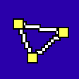

# Bikefit Simulator

Carries a bike fit from a reference to other frames. Everything sits on one grid:
the bottom bracket centre is (0, 0), X points forward, Y points up, lengths in mm.

1. **Library**: save the frames (their geometry), saddles (with the seatpost clamp) and cockpits you own.
2. **Input**, with Reference and Target side by side. Both only pick from what is saved in Library:
   - **Reference**, in two tabs, each holding as many as you need:
     - **Bike fit**: a frame, saddle and cockpit that fit you, and how they are set up: saddle height and setback, spacers, stem length and angle. Personal reach and drop are worked out from it. It needs a saved frame, saddle and cockpit with all their sizes; the app lists what is still missing.
     - **Personal fit**: just your numbers, with no frame: a saddle and cockpit, saddle height (straight line from the BB centre to the saddle tip), setback, personal reach and hand drop.
   - **Target**: bikes to set up like the bike fit or personal fit open in Reference, each a frame, saddle and cockpit (none picked = the reference's).
3. **Output**: saddle height along the new seat tube, setback, which seatpost (inline or 20 mm offset), stem and spacers, with drawings of both bikes.

## Hand position

The hand position is where the web between thumb and index finger touches the bar, given as Hand X and Hand Y: measured level and vertically from the top centre of the stem's handlebar clamp. It can be on the tops, the hoods, the drops or a flat bar's grips. Measure personal reach to that same point.

A target bike keeps the reference's personal reach and drop. With a saved cockpit it uses that cockpit's hand position and hand width, so wider hands sit a little further back to keep the same personal reach. Its stem and spacers are chosen to put the hands there. Handlebars are only representative: their drop, reach, diameter and rise draw a simple bar (level drops, no hoods; a flat bar with no reach is drawn end-on), and the calculation only uses the hand position and hand width.

## Limitations

- The simulation isn't possible if the same saddle position is not achievable.
- You need each frame's geometry and a few measurements, so some knowledge of bike geometry helps.
- Manufacturers' geometry charts aren't always exact.
- Every saddle is taken to be level.
- Crank length affects a bikefit, every bike is assumed to use the same.
- Results are estimates. Check the setup on the bike before riding.

## Folders

| Path | What it holds |
|---|---|
| `src/engine.js` | All the maths: stack and reach from the tubes, fit points, stem and spacer search, saddle position. No DOM, runs in Node. |
| `src/draw.js` | Side view and close-up drawings (SVG). |
| `src/app.js` | Page logic: inputs, results, summary, saving, step buttons. |
| `src/datafile.js` | Saving to and opening a data file on your computer. |
| `src/base.css`, `src/body.html` | Styles and page layout. |
| `src/retro.css` | The look: classic DOS colours (16-colour palette), windows, buttons. Loaded after the other styles. |
| `test/engine.test.js` | Checks for the engine. |
| `docs/model.md` | The calculation model and its formulas. |
| `build.py` | Joins the sources into one page. |
| `dist/` | Built pages (generated, don't edit). |

## Build and test

```
python3 build.py            # writes dist/bikefitsim.html
node test/engine.test.js    # runs the engine checks
```

Open `dist/bikefitsim.html` in a browser to try changes. It saves in that browser only.

## GitHub Pages

Branches: `dev` is where work happens; `master` holds releases.

The repository lives in the `BikefitSim` organization as `bikefitsim.github.io`, so the site sits at the root of that address.
Every push to `master` runs `.github/workflows/pages.yml`: it runs the engine checks, builds the page and publishes it at
**https://bikefitsim.github.io/**.

One-time setup on GitHub: **Settings > Pages > Build and deployment > Source: GitHub Actions**, and `master` as the default branch
(the `github-pages` environment only lets the default branch deploy).
Pages is free for public repositories; a private one needs a paid plan.

The Pages copy saves in the visitor's browser. In Chrome or Edge it can also save to a linked data file; elsewhere,
download and open one. The same file, or a share link, moves your bikes between it and a local copy.

## Where your data is saved

The app starts with one empty bike fit, one empty personal fit and one empty target bike. What happens to your numbers depends on where it runs:

- **Opened from your computer** (`dist/bikefitsim.html`, or a local server): every change is saved in this browser and comes back next time.
- **The public web copy** (GitHub Pages): every change is saved in this browser and comes back next time. Use the data file to keep a copy elsewhere.

The bar under the header handles the data file, a plain JSON file such as `data/bikefit-data.json`:

- **Chrome or Edge:** "Save to a file" links a file once and every change is written to it. On the next visit, one click on "Reconnect" picks it up again. "Open data file" loads another file after asking to replace what is on screen.
- **Other browsers:** "Download data file" saves a copy and "Open data file" loads one.
- **Share link:** "Copy share link" packs everything on the page into a short link to the public site (values by position, then compressed: a few hundred characters for a couple of bikes). Opening it shows those bikes straight away on a fresh page, or asks before replacing what is there. The data travels in the part of the address after `#`, which browsers don't send to the server.

When more than one copy exists, the newest wins on load.

`data/` and `*.bikefitsim.json` are in `.gitignore`, so your own measurements stay out of the repository.

The saved shape is version 3 and only ever gains fields, so older saves and files keep loading.

## Credits and contact

Made by José Miguel Moreira, under the MIT License. Type: the monospace font of your system.

Questions, wrong numbers or ideas: zmdmoreira@gmail.com
